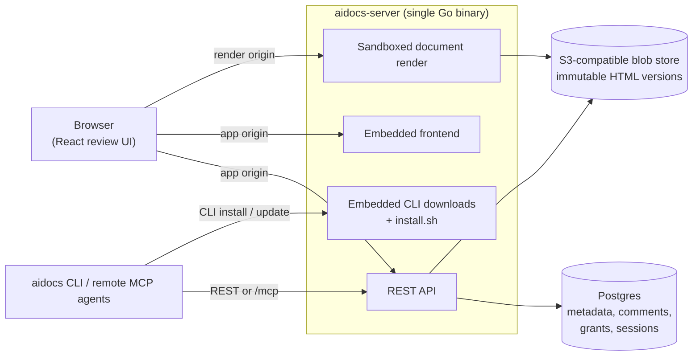

# aidocs

Give your agents the power to publish beautiful, reviewable documents.

`aidocs` is a GitHub-like collaboration layer for AI-generated documents. Agents create rich, self-contained HTML reports, specs, dashboards, diagrams, and decision docs; teams organize them into repositories and review protected changes through pull requests, approvals, comments, versions, and sharing.

Instead of pasting giant reports into chat, let agents push a document, iterate on feedback, and keep a durable review trail.

## What you can build with it

- Agent-generated architecture reviews
- Incident reports and postmortems
- Product specs and launch plans
- Data analysis reports
- Design proposals with Mermaid/SVG diagrams
- QA findings and browser-test reports
- Internal dashboards captured as portable HTML

## Features

- One self-contained HTML file per document
- Browser review UI with sandboxed rendering
- Anchored comments and resolve/reopen workflow
- Immutable versions with optimistic concurrency
- OpenID Connect for human users (Google, Okta, Entra ID, Keycloak, Dex, ...)
- Personal and organization-scoped document repositories
- Organization repositories discoverable by everyone in the workspace
- Nested repository folders with inherited email access
- Protected multi-document updates through pull requests and approvals
- Atomic create, update, rename, move, and delete change sets
- Successive pull-request patchsets, stale-base rebasing, and approval dismissal
- Direct rendered-text editing with no HTML or Markdown exposed in the UI
- Human-readable text-only pull-request diffs
- Connected GitHub, Slack-thread, and DevRev-ticket sources that turn external changes into reviewable doc PRs
- Signed, deduplicated webhooks, path filters, sync history, and provenance
- Repository search, cited Q&A, backlinks, dependency graphs, and freshness
- Review inbox, notifications, teams, templates, audit activity, and public portals
- Activity profiles for documents, pull requests, reviews, and merges
- Personal settings for account, appearance, agents, and developer access
- Stale-base and requested-changes merge protection
- Native service accounts for headless/agent workflows
- Remote MCP endpoint with browser OAuth—no local MCP process or CLI required
- Go CLI with compact default output and JSON mode
- Generated OpenAPI/Swagger docs
- Self-hostable Go server with embedded React frontend
- Dockerfile for container deployments

## Why one HTML file?

A single HTML artifact is easy for agents to generate, easy to version, easy to archive, and easy to move through a CLI. Images can be embedded with base64 data URLs, and diagrams can be Mermaid, inline SVG, or rendered HTML/CSS.

```html

```

No separate image hosting is required for v1.

## Quickstart (docker compose)

The fastest way to try aidocs is the bundled compose stack, which brings up
the server with Postgres, MinIO, and a [Dex](https://dexidp.io/) identity
provider — no cloud accounts or OAuth setup needed:

```bash
git clone https://github.com/razorpay/aidocs.git
cd aidocs
docker compose up --build
```

Open <http://localhost:8080> and sign in as `admin@example.com` with password
`password`.

Dex is the **development** login only. Real deployments configure Google or
any other OIDC provider — see [Self-hosting](docs/self-hosting.md).

`make e2e` boots the same stack and runs the full non-interactive smoke test
(login, documents, comments, sharing, folders, sandboxed rendering, SSE).
`make e2e-browser` runs the advisory Chromium browser suite. It reuses a healthy
aidocs + Dex stack already listening on ports 8080 and 5556; otherwise it boots
the isolated `aidocs-e2e` compose project and leaves it running for inspection.
Browser E2E is deliberately separate from `make ci`.

Tear down the isolated E2E project, including data volumes, with:

```bash
scripts/e2e.sh down
```

If you started the normal quickstart project with `docker compose up`, stop that
project with `docker compose down -v` instead.

## Install from source

```bash
git clone https://github.com/razorpay/aidocs.git
cd aidocs
make build
```

Binaries are written to:

```text
bin/aidocs-server
bin/aidocs
```

## Run with Docker

Release images are published to Docker Hub:

```bash
docker pull razorpay/aidocs:latest
```

Copy [`.env.example`](.env.example) to `.env`, fill it in, and run (pin an exact
tag or digest in production rather than `:latest`):

```bash
docker run --rm -p 8080:8080 --env-file .env razorpay/aidocs:latest
```

See [Self-hosting](docs/self-hosting.md) for production setup and all environment variables. A Kubernetes Helm chart is available in [`charts/aidocs`](charts/aidocs).

## Connect an MCP client

The application server exposes Streamable HTTP directly at:

```text
https://your-aidocs-host.example/mcp
```

Add that URL to a remote MCP client. Standards-based clients discover the
server's OAuth metadata, open the normal aidocs sign-in and consent flow, and
receive a short-lived, audience-bound token using authorization code + PKCE.
No aidocs CLI or local MCP bridge is involved. Unattended agents can instead
send an aidocs service-account key as a bearer token.

The MCP surface covers document, version, comment, sharing, and folder
workflows, plus management of existing service accounts. Creating service
accounts or bearer keys is intentionally not exposed over MCP; mint those
credentials in the web application or CLI. Client-local operations such as
installing or updating the CLI, switching local contexts, or opening a browser
are also not MCP tools.

## CLI quickstart

```bash
aidocs auth login localhost:8080
aidocs auth whoami

aidocs docs create report.html --title "Agent report"
aidocs docs list
aidocs docs pull doc_123 --out report.html
aidocs docs push doc_123 report.html --summary "Update findings"

aidocs docs comments list doc_123
aidocs docs comments create doc_123 --quote "important text" --body "Please clarify this."
aidocs docs comments resolve doc_123 cmt_123
```

Create an empty repository (or pass `--document-id` / `--folder-id` to seed one),
then propose protected updates without changing the published version:

```bash
aidocs repos create --name "Payments handbook" --scope organization
aidocs repos list

aidocs repos prs create repo_123 doc_123 handbook.html \
  --title "Clarify refund ownership" \
  --summary "Address operations feedback"
aidocs repos prs review repo_123 1 --approve --body "Looks good."
aidocs repos prs merge repo_123 1

# Repository owners can permanently remove the repository and its contents:
aidocs repos delete repo_123
```

Repositories may start empty, from a loose document, or from a root folder. An
empty repository can be initialized with one clean document directly in the UI;
after that bootstrap, protected document changes use pull requests. A single
change set can create, update, rename, move, or delete several documents and is
validated and merged atomically.

Connect a GitHub repository and test its documentation impact without needing
provider credentials by supplying the changed paths explicitly:

```bash
aidocs repos sources add repo_123 \
  --provider github \
  --repository razorpay/payments \
  --branch master \
  --include 'docs/**,api/**' \
  --target-document doc_123

aidocs repos sources simulate repo_123 source_123 \
  --after local-test \
  --changed-file api/refunds/handler.go

aidocs repos sources check repo_123 source_123 \
  --after local-test \
  --changed-file api/refunds/handler.go
```

`simulate` is read-only. `check` records the run and opens or updates a normal
aidocs pull request when an included path changed. See
[Connected sources](docs/connected-sources.md) for GitHub, Slack, and DevRev webhook setup and the
full local workflow.

Use `--json` for structured output:

```bash
aidocs --json docs list
```

## Development

For the fastest local loop, run the dev-only in-memory server from the source
checkout:

```bash
aidocs-dev
```

`aidocs-dev` is deliberately separate from the `aidocs` CLI. If the development
launcher is not installed on your `PATH` yet, run `make install-dev` once or use
`./aidocs-dev` directly.

This rebuilds the React app, syncs it into the server's embedded assets, and
starts aidocs at `http://127.0.0.1:8080`. It does not require Docker Compose,
Postgres, Google OAuth credentials, or S3. `Ctrl-C` stops the foreground server
cleanly. Local state is ephemeral; use
`http://127.0.0.1:8080/__dev` to switch between the seeded owner and
reviewer identities and exercise the approval flow. The launcher prints direct
owner and reviewer links that return to the repository list after switching.

The launcher also exposes the common local workflow:

```bash
aidocs-dev help
aidocs-dev test
aidocs-dev clean
```

Dependencies are installed with `npm ci` when `frontend/node_modules` is
missing or its lockfile is stale. Set `AIDOCS_DEV_NPM_INSTALL=always` for a clean reinstall,
`AIDOCS_DEV_NPM_INSTALL=never` to use the current install, or
`AIDOCS_DEV_SKIP_FRONTEND=1` when the embedded frontend is already current.
Set `AIDOCS_DEV_PORT` to use a loopback port other than `8080`.

The production build and server remain available through the Make targets:

```bash
make build
make swagger
make test
make verify-production
make verify-production-image
```

`make verify-production` is the full local production-runtime gate. It builds
the real server and embedded UI, provisions fresh PostgreSQL and S3-compatible
storage, applies migrations, and verifies atomic imports and rollback,
protected pull requests, signed Slack/DevRev events, persistence across restart,
Helm wiring, and dependency readiness. `make verify-production-image` additionally
builds and boots the actual Dockerfile artifact as the Helm non-root user with a
read-only root filesystem and bounded writable `/tmp`; it requires Docker
Buildx and access to the Dockerfile's public base images. See
[Production verification](docs/production-verification.md) for the exact
assertions and prerequisites.

Useful targets:

```text
make build          build server and CLI
make build-backend  build API server
make build-cli      build CLI
make build-frontend build embedded frontend assets
make swagger        regenerate OpenAPI docs
make test           run backend, CLI, and frontend tests
make lint           run Go, TypeScript, React, and formatting checks
make e2e            run the API and CLI compose smoke test
make e2e-browser    run the advisory Chromium browser suite
make verify-production run the production-parity integration gate
make verify-production-image also verify the restricted Dockerfile artifact
```

Build the server through `make build-backend` rather than a bare `go build`.
The target regenerates the iframe bridge and links its source fingerprint so
startup can reject missing, stale, or corrupt embedded assets.

## Architecture

Everything ships as one Go binary, `aidocs-server`. It serves the REST API, the embedded React frontend, and the embedded per-platform CLI binaries (`/install.sh` and downloads). You bring Postgres and an S3-compatible bucket. The same binary answers on two hostnames: the app hostname for the authenticated UI and API, and a separate render hostname where document HTML is served inside a sandboxed frame — the browser's same-origin policy keeps untrusted documents away from your session.



## Project layout

```text
api/       Go API server and embedded frontend assets
cli/       Go CLI
frontend/  React + Vite frontend
docs/      Self-hosting and operator docs
```

## API docs

When the server is running:

```text
/openapi.json
/api-docs
/commit.txt
```

## Security model

Uploaded HTML should be treated as untrusted content. `aidocs` renders documents in a sandboxed frame and requires app and render URLs on different hostnames. Scheme or port differences on the same hostname do not isolate cookies; the unsafe override is for local development only.

## Telemetry

None. `aidocs` collects no telemetry, analytics, or usage data, and phones home to no one. The only outbound calls the server makes are to your Postgres, your blob storage, and your configured OpenID Connect provider during login.

## License

MIT — see [LICENSE](LICENSE).
