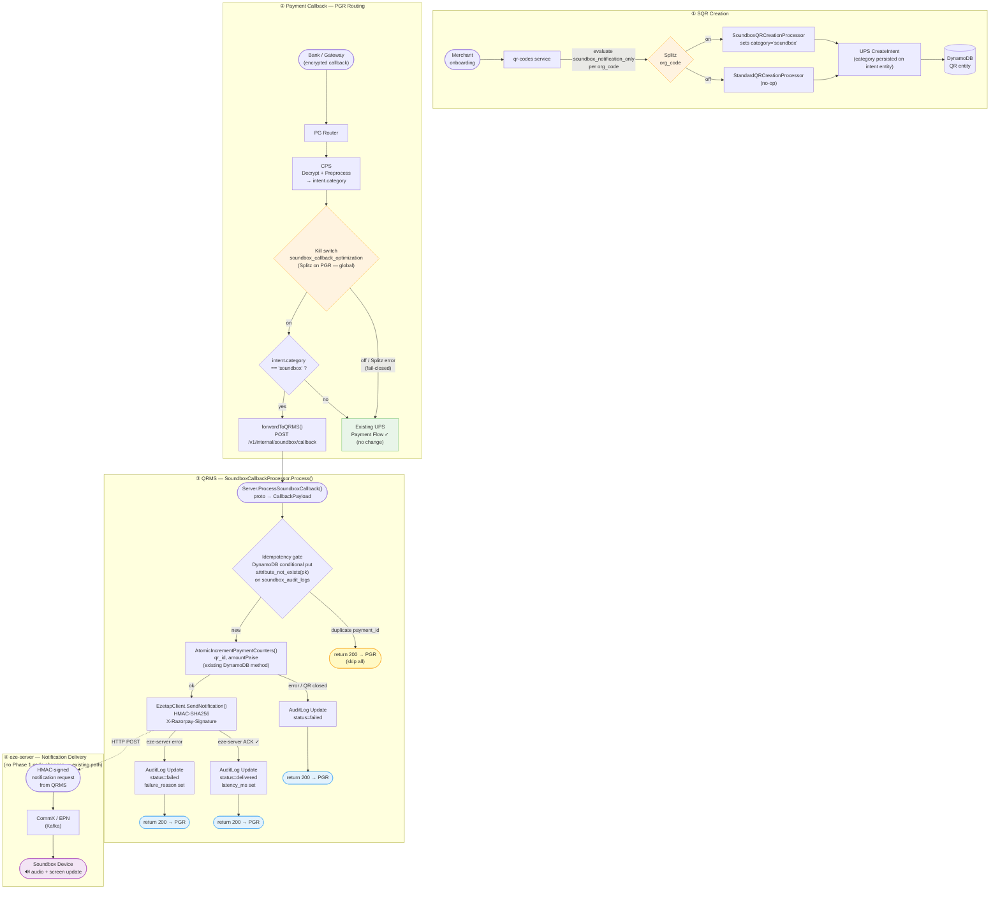

# SoundBox SQR Cost Reduction — Agent

**Objective:** Reduce per-transaction cost for SoundBox Static QR payments from **14.21p → ~3p** by routing notification-only callbacks directly to QRMS, skipping full UPS payment processing.

**Quality score: 8.7 / 10** — cross-referenced against `qr-codes`, `pg-router`, `payments-upi`, and `eze-server` codebases.

---

## The Problem

Every SoundBox SQR transaction currently triggers 4–6 DB writes and full UPS payment processing. For bank-led merchants (JnK Bank, Indian Bank), the bank owns the transaction record — Razorpay's only job is to deliver an audio alert and update the QR counter. The full pipeline is unnecessary and costs ~14.21p/txn.

---

## The Solution (Phase 1)

Route callbacks for `category="soundbox"` intents directly from PGR to QRMS (qr-codes service), skipping UPS payment processing entirely. `category="soundbox"` is set at QR creation time via a Splitz experiment evaluated per `org_code` — no hardcoded list.

---

## Architecture Diagram



---

## Quick Start

Open this directory in Claude Code and ask for a task:

```bash
cd Agents/soundbox-optimization
claude
```

**Example prompts:**
- `implement P1-1` — org code constants in qr-codes
- `implement P1-7` — soundbox callback HTTP handler
- `implement P1-9` — eze-server DB write suppression
- `implement Phase 1` — full Phase 1, repo by repo
- `write unit tests for P1-7`
- `what are the deploy steps for Phase 1?`

The agent reads `SKILL.md` to decide which context files to load before writing any code.

---

## Phase 1 Status

| Task | Description | Repo | Status |
|------|-------------|------|--------|
| P1-1 | Org code constants | `qr-codes` | Ready to implement |
| P1-2a | `category` field in UPS proto + preprocess response | `payments-upi` | Needs UPS/CPS team confirmation |
| P1-2b | Pass `category="soundbox"` on intent creation | `qr-codes` | Ready (after P1-2a) |
| P1-3 | PGR Splitz kill switch + routing to QRMS on `soundbox` category | `pg-router` | Ready (after P1-2a) |
| P1-4 | AuditLog DynamoDB table + model + repo | `qr-codes` | Ready |
| P1-5 | EzetapService config | `qr-codes` | Ready |
| P1-6 | Ezetap HTTP client (HMAC-SHA256) | `qr-codes` | Ready |
| P1-7 | Soundbox callback HTTP handler | `qr-codes` | Ready |
| P1-8 | OTel metrics | `qr-codes` | Ready |
| ~~P1-9~~ | ~~eze-server DB write suppression~~ | — | **Not in scope** — UC-1 callbacks come exclusively through PGR, never reach eze-server as payment events |
| P1-10 | payments-upi safety-net early-exit | `payments-upi` | Ready (after P1-2a) |
| P1-11 | Dashboards + alerts | — | Last |

**Deploy order:** `payments-upi (P1-2a)` → `qr-codes` → `payments-upi (P1-10)` → `pg-router` (activation, kill switch OFF → flip ON)

---

## Directory Map

```
soundbox-optimization/
  CLAUDE.md                  ← agent workflow: plan → implement → test → PR
  SKILL.md                   ← which files to load for each task type
  README.md                  ← this file

  context/
    project-overview.md      ← cost target, initiative scope, phase breakdown
    architecture.md          ← confirmed end-to-end callback flow
    key-decisions.md         ← architectural decisions log (2026-06-30)
    repos-and-files.md       ← exact files to create/modify per repo

  domain/
    tech-spec.md             ← full technical specification (source of truth)
    business-rules.md        ← invariants: idempotency, counter order, refund rule
    uc-classification.md     ← UC-1 (notification-only) vs UC-2 (full history)
    db-schema.md             ← soundbox_audit_logs DynamoDB schema + Go model

  implementation/
    phase1-tasks.md          ← P1-1 through P1-11: code specs, test cases, deploy order
    phase2-tasks.md          ← placeholder (Kafka queue, AWS IoT, remove UPS)

  code-patterns/
    http-handler.md          ← gRPC-Gateway route, server.go pattern, SoundboxCallbackProcessor
    error-handling.md        ← error wrapping, best-effort pattern
    logging.md               ← structured fields, log levels
    metrics.md               ← OTel counters, SoundboxCounterUpdateTotal, RecordXxx
    config.md                ← EzetapService three-struct TOML pattern

  testing/
    patterns.md              ← handler test suite, 4 test cases, org code whitelist
    strategy.md              ← coverage rules, UAT checklist, rollback plan

  operations/
    nfrs.md                  ← p95 <3s, p99 <5s, 4M+ txns/month
    backward-compat.md       ← deploy order, safety gates, rollback per repo
    glossary.md              ← QRMS, PGR, CPS, UC-1, UC-2, AuditLog, KVStore, etc.
```

---

## Key Facts

| | |
|-|-|
| Primary repo | `github.com/razorpay/qr-codes` |
| Local path | `/Users/akash.mukherjee/go/src/github.com/razorpay/qr-codes` |
| DynamoDB library | `aws-sdk-go-v2` + `goutils/kvstore` (tags: `kvstore:"field"`, not `dynamodbav`) |
| Idempotency | DynamoDB conditional put on `soundbox_audit_logs.payment_id` (no Redis) |
| Audit write | Synchronous after eze-server ACK — not a goroutine |
| UC classification | Splitz experiment `soundbox_notification_only` per `org_code` — no hardcoded org list |
| Onboarding new bank | Enable their merchants in the Splitz experiment dashboard — no code deploy |
| Processor pattern | `SoundboxCallbackProcessor` owns all UC-1 logic; handler is thin dispatch only |
| Cost target | 14.21p → ~3p per transaction |
| Phase 2 | Kafka queue + AWS IoT + remove UPS from SQR flow |
